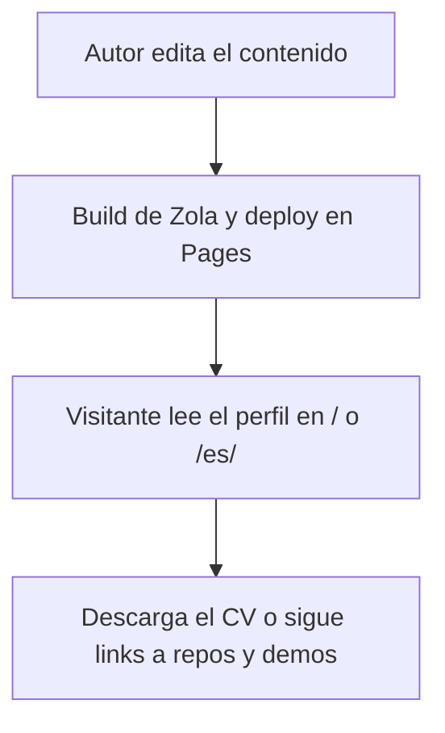

# Módulo: site

> El sitio público egonik-unlp.github.io: la página de perfil bilingüe y los subsitios estáticos que
> se publican junto a ella (el deck de Lensing y la descarga de snappec-verify).

## Diagrama de alto nivel
<!-- DERIVADO. Flujos del módulo, NO el call graph. Pasos de negocio, no funciones. -->

## ¿Qué quiero hacer?
| Quiero… | Flujo |
|---|---|
| Ver el perfil, descargar el CV o seguir los links a repos y demos | [[modules/site/use-cases/profile-page/flow.md]] |
| Editar el texto, las publicaciones o las imágenes y publicarlo | [[modules/site/use-cases/profile-page/flow.md]] |

## Notas transversales
- `/lensing-presentation/` y `/snappec-verify/` viven en `static/` y deben conservar sus URLs.

## Relacionados
N/A
