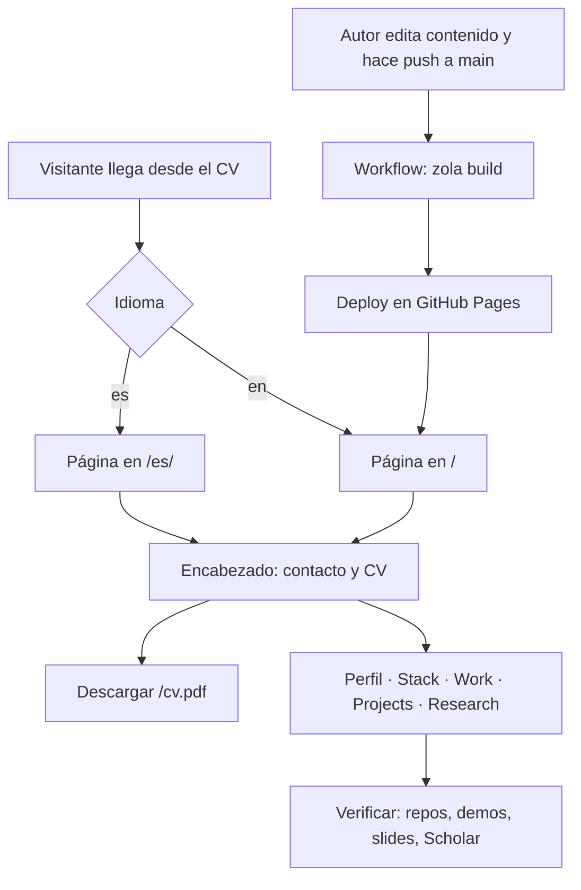

# Flujo: profile-page — leer el perfil y publicarlo

> **Aplica.** Un visitante llega (casi siempre desde el link del CV) y recorre una sola página de perfil
> en su idioma; el autor la mantiene editando archivos de contenido que el workflow publica en Pages.

## Actores
- **Visitante:** recruiter que hace drill-down desde el CV, o líder técnico que revisa el trabajo.
- **Autor:** Eduardo, que edita el contenido.
- **Workflow de Pages:** build de Zola y deploy en GitHub Pages.

## Flujo principal
1. **Visitante** abre `/` (inglés) o `/es/` (español) -> el **sitio** sirve la página estática del
   idioma, con `lang` y `hreflang` correctos. (ref: `` `templates/index.html` ``)
2. **Visitante** lee el encabezado -> encuentra nombre, rol y ubicación, links de contacto y el botón
   "CV (PDF)". Al seguirlo -> descarga `/cv.pdf`.
3. **Visitante** sigue leyendo -> perfil, Stack (herramientas habituales en etiquetas rellenas, las demás
   con borde), Work, Projects y Research, en ese orden.
4. **Visitante** quiere verificar -> sigue los links de repo, demo en vivo, slides, Scholar o las
   herramientas del laboratorio, que llevan a fuentes externas.
5. **Visitante** cambia de idioma -> el link del encabezado lo lleva a la misma página en el otro idioma.
6. **Autor** edita el texto (front matter + cuerpo de `content/_index.md` / `_index.es.md`) o las
   publicaciones (`data/publications.toml`) y hace push a `main` -> el **workflow** corre `zola build`
   con la versión fijada y despliega `public/` en Pages. (ref: `` `.github/workflows/gh-pages-deploy.yml` ``)

## Ramas y errores
- Si una entrada declara una imagen que no existe -> se muestra sin imagen; no hay marco vacío.
- Si el visitante no tiene JavaScript -> la página es la misma: no hay JS.
- Si el visitante está en un teléfono -> todo pasa a una columna; las etiquetas del Stack hacen wrap.
- Si el navegador tenía un CSS viejo en caché -> el link al CSS lleva hash (`?h=`), así que pide el nuevo.
- Si alguien pide un JSON legado (`/assets/data/projects.json`) -> 404.
- Si se publica una versión nueva de snappec-verify -> el script la deja en `static/snappec-verify/` y
  el próximo build la sirve en `/snappec-verify/latest/` y `/snappec-verify/versions/<v>/`.

## Casos de error / rechazo
| Causa | Resultado |
|---|---|
| Imagen declarada pero ausente | La entrada se renderiza sin imagen |
| Pedido a `/assets/data/*.json` | 404 |

## Permisos
N/A — página pública.

## Diagrama
<!-- DERIVADO de la prosa. Si divergen, manda la prosa. -->

## Referencias
- Contrato: [[openspec/specs/profile-page/spec.md]]
- Decisiones: [[modules/site/use-cases/profile-page/decisions.md]]
- Módulo: [[modules/site/INDEX.md]]
